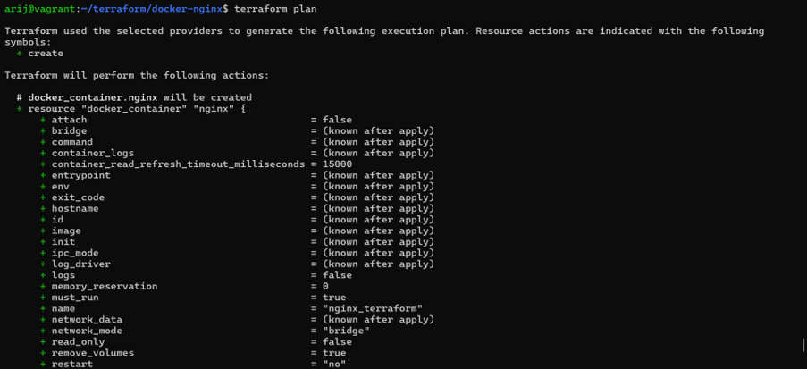
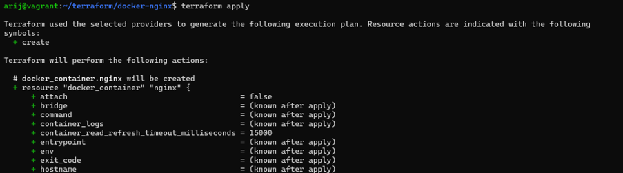
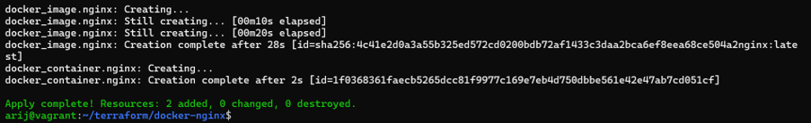
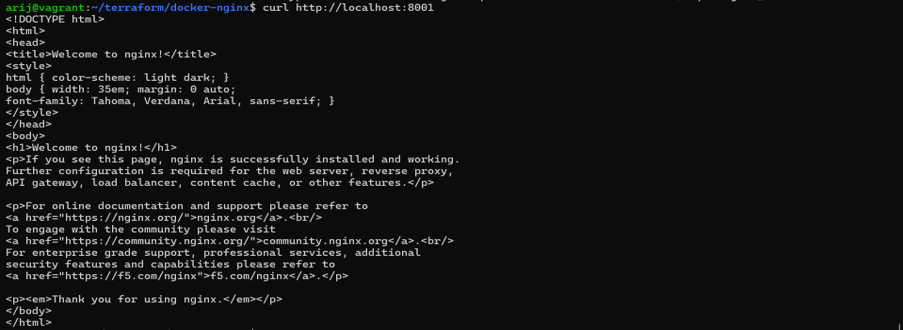
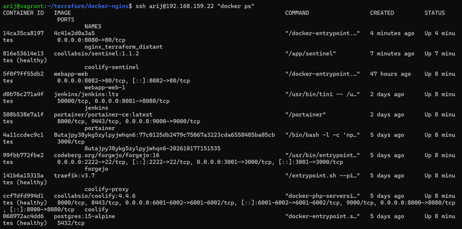
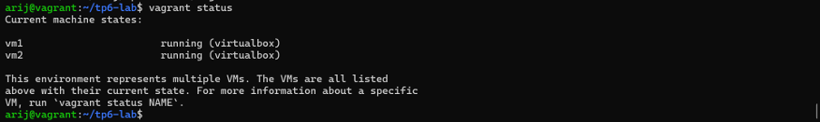
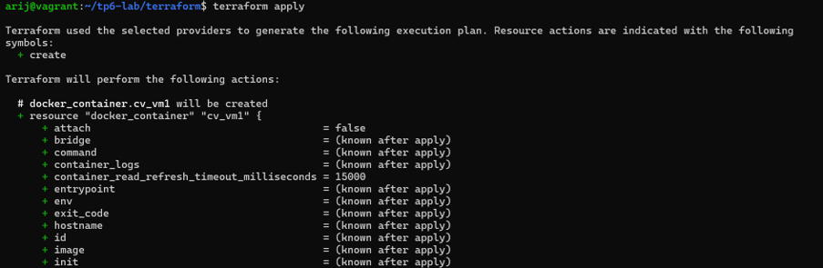
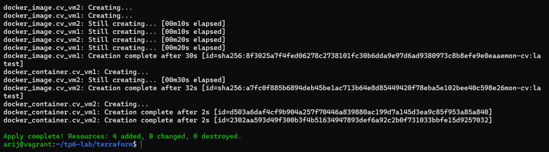
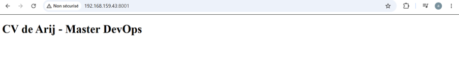
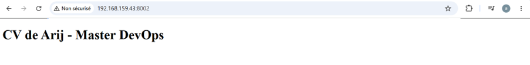

  <h1>🌍 TP6 : Infrastructure as Code avec Terraform</h1>
  
<strong>Gestion d'infrastructure avec Terraform, Docker, Vagrant et Ansible</strong>

  
  
  
  
  

 

> **Objectif :** Maîtriser Terraform pour créer et gérer des ressources Docker, d'abord en local, puis sur des machines distantes via SSH. Le TP se termine par un lab d'intégration complet (Vagrant + Ansible + Terraform) déployant un CV One Page sur deux VMs.

   
  📄 <strong><a href="./TP6.pdf">Télécharger le rapport complet du TP6 (PDF)</a></strong>
    

---

## 🐳 Partie 1 : Terraform avec Docker Local

Création d'un conteneur Nginx en local avec le provider `kreuzwerker/docker`. Test de la création des ressources.

### Planification (Plan)

### Application et vérification (Apply)
Le conteneur tourne et le site Nginx répond correctement sur `localhost:8001`.

---

## 🌐 Partie 2 : Terraform avec Docker Distant (via SSH)

Utilisation de Terraform pour piloter le Docker d'une VM distante (VM `.22` du TP4) via SSH. Le conteneur `nginx_terraform_distant` a bien été créé sur la machine distante sur le port `8080`.

---

## 🚀 Partie 3 : Le Lab d'intégration (Vagrant + Ansible + Terraform)

Création de 2 VMs avec Vagrant, installation de Docker avec Ansible, et déploiement du CV One Page avec Terraform sur les deux VMs.

### Vagrant et Ansible
Les deux VMs (`vm1` et `vm2`) sont opérationnelles et Ansible a installé Docker avec succès (`failed=0`).

### Déploiement Terraform
Terraform construit l'image du CV directement sur les deux VMs distantes et lance les conteneurs.

### Le CV déployé sur les 2 VMs
Le CV One Page est accessible depuis le navigateur de l'hôte sur le port 8001 (VM1) et 8002 (VM2).

---
*Réalisé par [Arij Belaid](https://github.com/arijbelaid) dans le cadre du cours de DevOps.*
